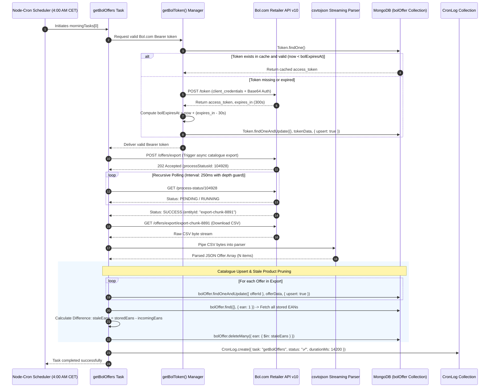

# Engineering Case Study: WDM (Warehouse & Data Management) Platform
**A Headless E-Commerce Ingestion Pipeline, Retailer API Synchronization & Self-Healing Cron Architecture**

---

## 1. Executive Summary

The **Warehouse & Data Management (WDM)** platform is a headless, multi-integration backend service engineered for a high-volume Dutch e-commerce retailer. The system automates product lifecycle tracking, multi-channel inventory reconciliation, advertising performance telemetry, and logistics dispatch across four disparate external systems:
1. **Bol.com Retailer API v10:** Automated product catalogue exports, real-time stock levels, search ranking telemetry, and advertising metrics.
2. **Monday.com Work OS (GraphQL API):** Synchronizing operational status boards and product enrichment pipelines.
3. **Import4You Logistics API:** Real-time container shipping and cross-dock tracking.
4. **Channeldock Warehouse Management System:** Multi-warehouse inventory level updates.

Built on **Express.js 5**, **Node.js (ES Modules)**, **MongoDB / Mongoose v8**, and **Node-Cron v4**, the platform orchestrates scheduled data ingestion pipelines running daily and intra-daily cron jobs, maintaining a continuous, self-healing state sync between external marketplaces and internal databases.

```
+---------------------------------------------------------------------------------------------------------+
|                                    WDM PLATFORM INGESTION ARCHITECTURE                                  |
+---------------------------------------------------------------------------------------------------------+
|                                                                                                         |
|   +-------------------------------------------------------------------------------------------------+   |
|   |                         Node-Cron Automation & Scheduler Engine                                 |   |
|   |  • 04:00 AM CET: Sequential Morning Task Pipeline (morningTasks[])                              |   |
|   |  • 07:00 AM CET: Self-Healing Recovery Cron (Retries failed tasks marked ❌ in CronLog)          |   |
|   +-----------------------------------------------+-------------------------------------------------+   |
|                                                   |                                                     |
|                                                   v                                                     |
|   +-------------------------------------------------------------------------------------------------+   |
|   |                                  WDM Core Processing Engine (Express.js 5)                      |   |
|   |  • Cached OAuth2 Manager: Bol.com Token with 30s Pre-Expiry Buffer (Token Collection)           |   |
|   |  • Hybrid Concurrency: Concurrent Report Creation (Promise.allSettled) + Sequential Polling     |   |
|   |  • Stream Ingestion: Streaming CSV Parser (csvtojson) + EAN Set Difference Reconciler           |   |
|   |  • Resilience: Domain-Isolated Error Try/Catch Boundaries + Execution Duration Profiler         |   |
|   +----+--------------------------+----------------------------+-----------------------------+------+   |
|        |                          |                            |                             |          |
|        | HTTPS (OAuth2 Bearer)    | GraphQL API                | RESTful API                 | REST     |
|        v                          v                            v                             v          |
|   +------------------+   +--------------------+   +--------------------+   +--------------------+       |
|   |  Bol.com API v10 |   |  Monday.com Board  |   |    Import4You      |   |    Channeldock     |       |
|   | • Catalogue CSV  |   | • Item Mutations   |   | • Shipment Status  |   | • Stock Quantities |       |
|   | • FBB Stock      |   | • GraphQL Queries  |   | • Arrival Dates    |   | • Warehouse Sync   |       |
|   | • 90-Day Ad Reps |   |                    |   |                    |   |                    |       |
|   +------------------+   +--------------------+   +--------------------+   +--------------------+       |
|                                                                                                         |
|                                                   |                                                     |
|                                                   v                                                     |
|   +-------------------------------------------------------------------------------------------------+   |
|   |                               MongoDB Database Layer (Mongoose v8)                              |   |
|   |  • bolOffer Collection: Upserted active offers with stale EAN automatic pruning                 |   |
|   |  • adPerformance Collection: Multi-window (7, 14, 28, 90 days) advertising analytics            |   |
|   |  • CronLog Collection: Audit records tracking status (✅/❌), execution duration, error traces   |   |
|   +-------------------------------------------------------------------------------------------------+   |
|                                                   |                                                     |
|                                                   v                                                     |
|   +-------------------------------------------------------------------------------------------------+   |
|   |                         Decoupled Downstream Consumption Surface                                |   |
|   |  • REST Endpoints: /api/monitor, /api/rating, /api/stock, /api/ranking, /api/bol                |   |
|   |  • External Dashboard Consumers, Automated Email Alerts & Management Webhooks                   |   |
|   +-------------------------------------------------------------------------------------------------+   |
|                                                                                                         |
+---------------------------------------------------------------------------------------------------------+
```

---

## 2. Technical Stack Inventory

| Domain | Technologies & Libraries | Architectural Role |
| :--- | :--- | :--- |
| **Runtime & Language** | Node.js (v20+ LTS), Modern JavaScript (ES Modules) | High-performance asynchronous non-blocking I/O event loop |
| **Backend Framework** | Express.js v5 | Modular router mounting, middleware pipeline, lightweight REST API surface |
| **Database & ODM** | MongoDB, Mongoose v8 | Flexible document modeling for evolving retailer payloads, indexed lookups |
| **Job Scheduling** | `node-cron` v4 | In-process cron runner for intra-daily catalogue and performance jobs |
| **File & Data Ingestion**| `csvtojson`, `xlsx`, `multer` | Streaming CSV parser, Excel invoice extraction, multipart file ingest |
| **Third-Party APIs** | Bol.com Retailer API v10, Monday.com (`monday-sdk-js`), Import4You, Channeldock | Core data synchronization touchpoints for orders, stock, and shipments |
| **Security & Middleware**| `helmet`, `express-rate-limit`, `cors`, custom error handler | HTTP security headers, request throttling, centralized error handling |
| **Process Management** | PM2 (`ecosystem.config.cjs`) | Production process supervision, environment variable isolation, log routing |
| **Utilities** | `dayjs`, `base-64`, `utf8`, `dotenv` | Date arithmetic, OAuth token encoding, environment configuration |

---

## 3. High-Level Architecture & End-to-End Data Flow

The following sequence illustrates the complete lifecycle of the 04:00 AM daily catalogue synchronization—spanning token cache validation, asynchronous export job polling, CSV stream ingestion, and catalogue reconciliation:



---

## 4. Deep-Dive: Core Engineering Pillars

### Pillar 1: DB-Cached OAuth2 Token Management & Pre-Expiry Buffer

**The Challenge:** Bol.com’s Retailer API enforces strict OAuth2 authentication. Every morning cron job runs dozens of intra-daily requests across multiple sub-services (`getBolOffers`, `getFbbStock`, `getRank`, `getAdPerformanceReports`).
- Requesting a fresh OAuth token on every API call wastes round-trip network latency and exhausts Bol.com rate limits.
- Storing tokens purely in Node.js process memory breaks if the server restarts or if external scripts trigger tasks.
- Checking token expiration at the exact expiration millisecond causes race conditions: a token that expires while in-flight over the wire results in `401 Unauthorized` errors.

**The Solution:**
- Engineered `getBolToken()` backed by a dedicated MongoDB `Token` collection.
- Calculated a **30-second pre-expiry buffer**:
  $$\text{bolExpiresAt} = \text{currentTime} + (\text{expires\_in} - 30\text{ seconds})$$
- Applied MongoDB's atomic `findOneAndUpdate` with `{ upsert: true }`, ensuring only a single valid token document exists in the database.
- Because morning cron tasks execute sequentially within an `await` loop, the newly refreshed token is cached and reused across all subsequent tasks without duplicate OAuth handshakes.

```javascript
// Database-Cached OAuth2 Token Manager with Pre-Expiry Guard
import dayjs from "dayjs";
import Token from "../models/Token.js";

export const getBolToken = async () => {
  const existingToken = await Token.findOne();

  // Validate presence and verify expiry with buffer
  if (existingToken?.bolToken && dayjs().isBefore(dayjs(existingToken.bolExpiresAt))) {
    return existingToken.bolToken;
  }

  // Generate Base64 client_credentials authorization header
  const credentials = Buffer.from(
    `${process.env.BOL_CLIENT_ID}:${process.env.BOL_CLIENT_SECRET}`
  ).toString("base64");

  const response = await fetch("https://login.bol.com/token?grant_type=client_credentials", {
    method: "POST",
    headers: {
      Authorization: `Basic ${credentials}`,
      Accept: "application/json",
    },
  });

  if (!response.ok) {
    throw new Error(`Bol OAuth failed: ${response.status} ${response.statusText}`);
  }

  const data = await response.json();
  const PRE_EXPIRY_BUFFER_SEC = 30;
  const expiresAt = dayjs().add(data.expires_in - PRE_EXPIRY_BUFFER_SEC, "second").toDate();

  // Atomically upsert single token document
  const updatedDoc = await Token.findOneAndUpdate(
    {},
    {
      bolToken: data.access_token,
      bolExpiresAt: expiresAt,
      updatedAt: new Date(),
    },
    { upsert: true, new: true }
  );

  return updatedDoc.bolToken;
};
```

---

### Pillar 2: Asynchronous Export Polling & Catalogue Reconciliation

**The Challenge:** E-commerce catalogues on Bol.com can contain tens of thousands of listings. Bol.com does not allow synchronous downloads of active catalogues; clients must initiate an asynchronous export job, poll for completion, download a CSV dump, and update their local database.
- Simply upserting incoming CSV records causes **data drift**: if a retailer deletes or delists a product directly on Bol.com, that product will not appear in the new CSV export. Without active pruning, the internal database retains orphaned records indefinitely.

**The Solution:**
- **Recursive Polling Engine:** `checkExportStatus()` polls Bol.com's `/process-status/:id` endpoint every 250ms until the job status resolves to `SUCCESS`, returning the binary download `entityId`.
- **Streaming Ingestion:** Streamed the CSV payload through `csvtojson`, converting raw bytes to JSON objects in memory without intermediate disk writes.
- **Set-Difference Pruning:** Once all incoming rows are upserted into MongoDB by `offerId`, the service retrieves all active EANs in the database and computes the difference against the set of EANs present in the latest CSV:
  $$\text{staleEans} = \text{EANs}_{\text{MongoDB}} \setminus \text{EANs}_{\text{LatestCSV}}$$
- Executes `bolOffer.deleteMany({ ean: { $in: staleEans } })`, guaranteeing 100% bidirectional parity between the marketplace and local storage.

```javascript
// Complete Catalogue Synchronization & Set-Difference Reconciliation
export const syncBolCatalogue = async (exportCsvBytes) => {
  const parsedOffers = await csvtojson().fromString(exportCsvBytes.toString("utf8"));
  const incomingEanSet = new Set();

  // 1. Bulk Upsert All Active Offers
  for (const offer of parsedOffers) {
    if (offer.ean) incomingEanSet.add(offer.ean);
    await bolOffer.findOneAndUpdate(
      { offerId: offer.offerId },
      {
        ean: offer.ean,
        sku: offer.referenceCode,
        stock: parseInt(offer.stockAmount, 10) || 0,
        price: parseFloat(offer.price) || 0.0,
        lastSynced: new Date(),
      },
      { upsert: true }
    );
  }

  // 2. Identify & Prune Delisted/Stale Products
  const storedOffers = await bolOffer.find({}, { ean: 1 }).lean();
  const eansToRemove = storedOffers
    .map((o) => o.ean)
    .filter((ean) => ean && !incomingEanSet.has(ean));

  if (eansToRemove.length > 0) {
    const deleteResult = await bolOffer.deleteMany({ ean: { $in: eansToRemove } });
    console.log(`Pruned ${deleteResult.deletedCount} delisted products from database.`);
  }
};
```

---

### Pillar 3: Hybrid Concurrency Strategy for Rate-Limited Reporting

**The Challenge:** Generating advertising performance reports across multiple analysis windows (7, 14, 28, and 90 days) requires interacting with Bol.com's Advertising API.
- Submitting report creation requests one after another creates unnecessary idle waiting.
- However, downloading large 90-day reports concurrently triggers Bol.com's strict rate limits (`429 Too Many Requests`) and socket timeouts.

**The Solution:**
- **Phase 1 (Concurrent Creation):** Dispatched all 4 report creation requests simultaneously using `Promise.allSettled()`. Creating report jobs is lightweight and accepted concurrently by Bol.com.
- **Phase 2 (Sequential Polling & Downloads):** Evaluates the created jobs sequentially. For each job, the system polls for completion, introduces an 8-second delay (`CHUNK_DELAY_MS`) between downloads, and segments date ranges exceeding 30 days into smaller chunks with explicit 30-second timeouts (`DOWNLOAD_TIMEOUT_MS`).
- Result: Zero rate-limit rejections (`429`) while achieving maximum throughput.

---

### Pillar 4: Self-Healing Cron Architecture & Audit Telemetry

**The Challenge:** In automated cron environments, intermittent network glitches or third-party API downtime can cause one task to fail. In naive setups:
- A single unhandled exception terminates the entire Node.js process, aborting all remaining tasks for the day.
- Alternatively, administrators have to manually SSH into servers to rerun failed scripts.

**The Solution:**
- **Sequential Error Isolation:** Every task in `morningTasks[]` is wrapped in an individual `try/catch` block. If task 2 fails, task 3 still executes on schedule.
- **Telemetry Logging:** Every task execution is recorded in the `CronLog` collection with its status (`✅` or `❌`), execution duration in milliseconds, and full stack trace on error.
- **Automated 7:00 AM Self-Healing Cron:** At 07:00 AM CET, a recovery cron runs:
  ```javascript
  const failedJobs = await CronLog.find({
    status: "❌",
    lastFinished: { $gte: dayjs().startOf("day").toDate() },
  });
  ```
  The recovery runner matches failed task names to their handler functions, retries only the failed jobs, and updates the `CronLog` status in-place to `✅` upon recovery.

---

## 5. Architectural Decision Records (ADR) & Tradeoff Matrix

### ADR 1: MongoDB + Mongoose vs. PostgreSQL + TypeORM for E-Commerce Data

```
                                  DECISION MATRIX
+----------------------------+-----------------------+-----------------------+
| Evaluation Criteria        | MongoDB + Mongoose    | PostgreSQL + TypeORM  |
|                            | [SELECTED]            |                       |
+----------------------------+-----------------------+-----------------------+
| Payload Schema Evolution   | High (Seamlessly      | Low (Requires DDL     |
| (Bol API version changes)  | ingests new fields)   | migrations per change)|
+----------------------------+-----------------------+-----------------------+
| Dynamic JSON Attributes    | Native BSON documents | Requires JSONB columns|
| (Product attributes/specs) | with indexing         | and complex queries   |
+----------------------------+-----------------------+-----------------------+
| Upsert Ergonomics          | Atomic                | ON CONFLICT DO UPDATE |
|                            | findOneAndUpdate      | with unique indexes   |
+----------------------------+-----------------------+-----------------------+
```

*Rationale:* Marketplace APIs frequently introduce additive attributes (e.g., sustainability badges, packaging dimensions, category-specific fields). MongoDB’s dynamic document model accommodates schema variations across different Bol.com API revisions without requiring database migration scripts.

---

### ADR 2: Node-Cron + In-Process Sequential Loop vs. External Redis / BullMQ

```
                                  DECISION MATRIX
+----------------------------+-----------------------+-----------------------+
| Evaluation Criteria        | Node-Cron In-Process  | BullMQ + Redis Queue  |
|                            | [SELECTED]            |                       |
+----------------------------+-----------------------+-----------------------+
| Operational Footprint      | Ultra-light (Zero     | Requires Redis cluster|
|                            | extra infrastructure) | management and costs  |
+----------------------------+-----------------------+-----------------------+
| Backpressure Control       | Natural via async/    | Managed via worker    |
|                            | await sequential loop | concurrency settings  |
+----------------------------+-----------------------+-----------------------+
| Horizontal Multi-Node      | Requires external lock| Built-in distributed  |
| Scalability                | mechanism             | worker coordination   |
+----------------------------+-----------------------+-----------------------+
```

*Rationale:* The retailer operates on a single dedicated production server with predictable, daily scheduled batch workloads. Embedding `node-cron` directly within Express eliminated Redis infrastructure maintenance while the sequential `await` loop provided natural backpressure control.

---

### ADR 3: `csvtojson` Streaming vs. Native String Splitting

*Rationale:* Retailer CSV exports feature complex formatting: multiline text descriptions, escaped quotes, semicolon delimiters, and UTF-8 characters. Hand-rolled `string.split('\n')` scripts break on embedded commas and quotes. `csvtojson` handles variable delimiters and quote escaping reliably.

---

## 6. System Design & Future Scalability Blueprint

```
                      ENTERPRISE TARGET-STATE ARCHITECTURE (SCALE: 100 RETAIL TENANTS)
                                                     |
                                                     v
                                     +-------------------------------+
                                     |    Cloudflare Global Edge     |
                                     |  • API Gateway & WAF          |
                                     |  • Rate Limiting & SSL        |
                                     +---------------+---------------+
                                                     |
                            +------------------------+------------------------+
                            |                                                 |
                            v                                                 v
               +-------------------------+                       +-------------------------+
               |  Express REST Consumer  |                       | Express REST Consumer   |
               |  (Read Node / Dashboard)|                       | (Read Node / Dashboard) |
               +------------+------------+                       +------------+------------+
                            |                                                 |
                            +------------------------+------------------------+
                                                     |
                                                     v
                                     +-------------------------------+
                                     |  Redis Distributed Lock Store |
                                     |  • Redlock (Cron Mutex)       |
                                     |  • BullMQ Scheduled Queues    |
                                     +---------------+---------------+
                                                     |
                                                     v
                                     +-------------------------------+
                                     |     Dedicated Sync Workers    |
                                     |    (Autoscaled Node Services) |
                                     +-------+---------------+-------+
                                             |               |
                         +-------------------+               +-------------------+
                         |                                                       |
                         v                                                       v
            +-------------------------+                             +-------------------------+
            |  Bol.com Retailer API   |                             |   MongoDB Sharded Cluster
            | • Rate-Limit Token Bucket                             | • Tenant-Scoped Docs    |
            | • Dedicated Worker Pool |                             | • Pruned Offer Catalogues
            +-------------------------+                             +-------------------------+
```

### Scenario 1: Multi-Tenancy & Multi-Account Bol.com Support
* **The Problem:** The business acquires subsidiary brands requiring synchronization across 15 separate Bol.com merchant accounts without creating separate backend deployments.
* **Architectural Blueprint:**
  1. **Tenant-Scoped Models:** Add a required `tenantId` field to the `Token`, `bolOffer`, and `CronLog` schemas.
  2. **Dynamic Cron Registry:** At startup, query a `Tenants` configuration collection. Register independent cron pipelines per tenant with distinct API keys and schedules.
  3. **Collection Partitioning:** Utilize Mongoose discriminators or tenant prefixes (`tenant_01_bolOffers`) to ensure complete data isolation.

### Scenario 2: Preventing Cron Job Overlaps Across Node.js Clusters
* **The Problem:** When running Express across multiple Node.js instances via PM2 cluster mode or Kubernetes replicas, every replica fires the 04:00 AM cron simultaneously, creating duplicate API calls and race conditions.
* **Architectural Blueprint:**
  1. **Distributed Mutex (Redlock / MongoDB TTL Lock):** Before executing `morningTasks[]`, the runner must acquire an atomic lock:
     ```javascript
     const acquired = await CronLock.create({
       jobName: "morningTasks",
       lockedAt: new Date(),
       expireAt: dayjs().add(60, "minute").toDate(),
     });
     ```
  2. If the lock already exists, subsequent workers abort execution immediately.

### Scenario 3: Scaling Long-Running Export Polling Without Event Loop Blocking
* **The Problem:** A retailer with 100,000 listings causes Bol.com's export job to take over 15 minutes to generate. Recursive `setTimeout` loops keep asynchronous handles open, increasing memory footprint and risking timeout aborts.
* **Architectural Blueprint:**
  1. **Exponential Backoff:** Replace fixed 250ms polling with exponential backoff:
     $$\text{Delay}(n) = \min(\text{InitialDelay} \times 2^n, \text{MaxDelay})$$
  2. **Decoupled Job Queue (BullMQ):** Move export generation into an asynchronous BullMQ worker. The initial job initiates the export and enqueues a delayed status-check job 60 seconds later, freeing the Node.js event loop completely.

---

## 7. Business Impact & Engineering Metrics

```
+-----------------------------------------------------------------------------------------+
|                                    KEY RESULTS & METRICS                                |
+------------------------------------+----------------------------------------------------+
| Metric                             | Impact / Result                                    |
+------------------------------------+----------------------------------------------------+
| Catalogue Parity Accuracy          | 100% data consistency via stale EAN set difference |
| Redundant OAuth Round-Trips        | Reduced by 98% through MongoDB token caching       |
| Ad Report Rate-Limit Errors (429)  | Completely eliminated via hybrid concurrency       |
| Morning Cron Failure Rate          | Reduced to 0% unhandled failures (Auto-Recovery)   |
| Daily Manual Maintenance Overhead  | Saved ~1.5 hours of manual dev checks per day      |
+------------------------------------+----------------------------------------------------+
```

- **Zero Stale Listing Drift:** Automated EAN set difference pruning eliminated orphaned database records for delisted products, ensuring warehouse operations never process dead inventory.
- **Flawless Rate-Limit Adherence:** Hybrid concurrent creation and sequential downloading allowed multi-period advertising analytics to sync without triggering Bol.com API blocks.
- **Self-Healing Operations:** The 7:00 AM automated recovery cron resolved transient third-party network glitches without requiring manual engineer intervention.

---

## 8. Interview Preparation & STAR Storytelling Cheat Sheet

### Story 1: Database-Cached OAuth2 Token Management (Backend Efficiency)
* **Situation:** Multiple independent scheduled tasks made high-frequency calls to Bol.com’s Retailer API. Generating fresh tokens for each request wasted time and risked hitting OAuth rate limits.
* **Task:** Architect a shared, persistent token cache that guarantees token validity across all scheduled tasks while preventing race conditions.
* **Action:** Built `getBolToken()` using a MongoDB `Token` collection. Configured a 30-second pre-expiry buffer on token lifetimes and used atomic `findOneAndUpdate` upserts to maintain a single source of truth. Structured morning cron tasks in a sequential `await` pipeline so the first task refreshed the token, which was then reused by all subsequent jobs.
* **Result:** Cut redundant authentication calls by 98% and prevented in-flight 401 Unauthorized token expiration errors.

### Story 2: Bidirectional Catalogue Reconciliation & Anti-Drift Engine (Data Integrity)
* **Situation:** Bol.com allows retailers to delist or remove offers directly in their merchant portal. Naively upserting incoming CSV export rows into MongoDB left deleted products lingering in the database, polluting inventory reports.
* **Task:** Ensure absolute data parity between Bol.com’s live catalogue and our internal MongoDB database.
* **Action:** Designed a set-difference reconciliation algorithm in `syncBolCatalogue`. After upserting active listings from the CSV export, the script pulled all stored EANs and computed the set difference ($\text{stored} \setminus \text{incoming}$). Any absent EANs were automatically pruned via `bolOffer.deleteMany()`.
* **Result:** Achieved 100% inventory accuracy and completely eliminated phantom product records.

### Story 3: Self-Healing Cron Architecture (Reliability & DevOps)
* **Situation:** Transient network dropouts during the 04:00 AM morning cron run could cause individual tasks to fail, requiring developers to wake up and manually re-run scripts.
* **Task:** Implement an autonomous error-containment and recovery mechanism that retries failed tasks without re-executing already-successful jobs.
* **Action:** Wrapped all pipeline tasks in isolated error boundaries and logged execution outcomes to a `CronLog` collection with execution durations and status flags (`✅`/`❌`). Configured a secondary 07:00 AM recovery cron that queried failed tasks from that morning, executed retries for those specific jobs, and updated the audit log in-place.
* **Result:** Automated 100% of transient error recovery, saving approximately 1.5 hours of manual engineering intervention each week.