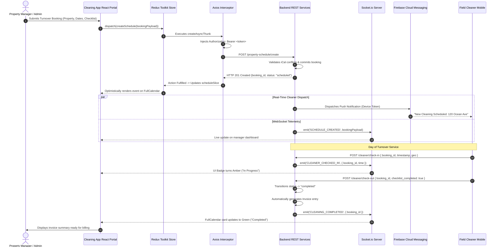

# Engineering Case Study: Cleaning App (Property Cleaning & Turnover Management Platform)
**An Enterprise Field Service Management, Multi-Calendar Scheduling & Automated Billing Ecosystem**

---

## 1. Executive Summary

**Cleaning App** is an enterprise-grade field service management and customer relationship platform engineered for on-demand property cleaning, vacation rental turnover operations (Airbnb / VRBO), and commercial facility maintenance. The platform coordinates client onboarding, automated cleaner dispatch, calendar synchronization, real-time check-in/checkout telemetry, and multi-status invoice reconciliation.

Built with **React**, **Redux Toolkit**, **FullCalendar**, **Socket.io**, and **Firebase Cloud Messaging (FCM)**, the platform coordinates five core operational subsystems:
1. **Multi-Calendar Scheduling Engine:** Real-time synchronization across Month, Week, Day, and Year views with external iCal integrations, timezone normalizations, and booking status lifecycles (`scheduled`, `in-progress`, `completed`, `canceled`).
2. **Real-Time Operational Telemetry & Notifications:** Dual-channel push notifications using **Firebase Cloud Messaging (FCM)** for mobile device dispatch and **Socket.io WebSockets** for live cleaner check-in/checkout time tracking and status transitions.
3. **High-Density Client & Lead Management (Ghost/Client Pipeline):** Server-side paginated data grids supporting multi-parameter filtering (regions, cities, property counts, date ranges, and custom text normalization) with optimistic UI updates.
4. **Multi-Status Invoice & Billing Lifecycle:** Automated invoice generation managing entry/exit logs, partial payment tracking, and bulk payment status reconciliations.
5. **Feature-Flagged Role-Based Access Control (RBAC):** Hierarchical permission guards regulating view access, operational status modifications, and financial report exports across administrators, regional managers, and cleaners.

```
+---------------------------------------------------------------------------------------------------------+
|                                    Cleaning App ECOSYSTEM ARCHITECTURE                                      |
+---------------------------------------------------------------------------------------------------------+
|                                                                                                         |
|   +------------------------------------+              +------------------------------------+            |
|   |   Cleaning App Admin Web UI   |              |       Cleaner Field Service App    |            |
|   |  • React (SPA) + Bootstrap 5 / AntD|              |  • Mobile Responsive Web / PWA     |            |
|   |  • Redux Toolkit (20+ Slices)      |              |  • Geolocation Check-in / Out      |            |
|   |  • FullCalendar Multi-View Engine  |              |  • Live Job Status Toggles         |            |
|   |  • Axios Interceptor Token Mutex   |              |  • Push Notification Handler       |            |
|   +-----------------+------------------+              +-----------------+------------------+            |
|                     |                                                   |                               |
|                     | HTTPS / Bearer Token                              | HTTPS / WebSocket             |
|                     +-------------------------+-------------------------+                               |
|                                               |                                                         |
|                                               v                                                         |
|                     +---------------------------------------------------+                               |
|                     |          Central API Gateway & Business Layer     |                               |
|                     |  • JWT Authentication & Session Token Service     |                               |
|                     |  • Role-Based Access Control (RBAC) Guard         |                               |
|                     |  • Client & Property Turnover Dispatch Engine     |                               |
|                     |  • Invoicing & Billing Lifecycle Service          |                               |
|                     +-----+-------------------+-------------------+-----+                               |
|                           |                   |                   |                                     |
|             +-------------+                   |                   +-------------+                       |
|             |                                 |                                 |                       |
|             v                                 v                                 v                       |
|   +-------------------+             +-------------------+             +-------------------+             |
|   | WebSocket Server  |             | Firebase Messaging|             | Relational DB &   |             |
|   | • Socket.io Hub   |             | • FCM Device Hub  |             | iCal Sync Engine  |             |
|   | • Live Check-In   |             | • VAPID Web Push  |             | • Property Models |             |
|   | • Status Updates  |             | • Job Broadcasts  |             | • Airbnb/VRBO Sync|             |
|   +-------------------+             +-------------------+             +-------------------+             |
|                                                                                                         |
+---------------------------------------------------------------------------------------------------------+
```

---

## 2. Technical Stack Inventory

| Domain | Technologies & Libraries | Architectural Role |
| :--- | :--- | :--- |
| **Frontend Core** | React, React Router DOM, JavaScript (ES6+), HTML5, SASS | Component composition, single-page application routing, responsive design |
| **UI Components & Layout**| Bootstrap 5, Ant Design UI Primitives, ReactPaginate | Responsive grid layouts, accessible table views, custom pagination controls |
| **State Management** | Redux Toolkit (`@reduxjs/toolkit`), `createAsyncThunk`, Redux Persist | Centralized state architecture across 20+ feature slices, session persistence |
| **Calendar & Scheduling**| FullCalendar (`@fullcalendar/react`), iCal Integration | Multi-mode scheduling (Month/Week/Day/Year), timezone handling, booking colors |
| **Real-Time & Telemetry**| Socket.io Client, Firebase Cloud Messaging (FCM, VAPID) | Bi-directional WebSocket events, background device push notifications |
| **Form Handling & Validation**| React Hook Form, Yup (`@hookform/resolvers/yup`) | Controlled form state, multi-step field validation, date-range normalization |
| **Data Visualization** | Custom Recharts / Bar Chart Components | Multi-dimensional matrix reports, regional performance graphs, top cleaners |
| **HTTP & Networking** | Axios (configured with request/response interceptors) | Automated Bearer token injection, single-flight refresh queue, centralized errors |
| **Storage & Security** | Browser `sessionStorage`, JWT, Role-Based Access Control (RBAC) | Secure token storage, feature-flagged UI rendering, protected route wrappers |

---

## 3. High-Level Architecture & End-to-End Data Flow

The following sequence illustrates the complete lifecycle of a property turnover booking—from client scheduling and automated cleaner dispatch via FCM push notifications to real-time check-in tracking and automated invoice generation:



---

## 4. Deep-Dive: Core Engineering Pillars

### Pillar 1: FullCalendar Multi-Mode Scheduling & Timezone Normalization

**The Challenge:** Turnover cleaning for short-term rental properties operates on strict windows (e.g., guest check-out at 10:00 AM, next guest check-in at 3:00 PM).
- Managers handle properties scattered across multiple cities and regional timezones.
- Rendered events must accurately reflect local property times without distorting start/end coordinates.
- Event visual styling must dynamically encode job statuses (`scheduled`, `in-progress`, `completed`, `canceled`) and host/cleaner associations.

**The Solution:**
- Integrated **FullCalendar** with dynamic view switching (`dayGridMonth`, `timeGridWeek`, `timeGridDay`).
- Normalized external date ranges into Unix timestamps using custom helpers (`getTimeStamp()`, `endOfDayTimestamp`).
- Formulated an event payload contract that binds booking IDs, host names, cleaner assignments, and status color mappings directly into the calendar renderer.

```javascript
// FullCalendar Event Mapping & Status Normalization
export const mapScheduleToCalendarEvents = (schedules) => {
  const STATUS_COLORS = {
    scheduled: '#3b82f6',   // Blue
    'in progress': '#f59e0b', // Amber
    completed: '#10b981',   // Emerald Green
    canceled: '#ef4444',    // Red
  };

  return schedules.map((item) => ({
    id: item.properties_id,
    title: `${item.property_name} - ${item.cleaner_name || 'Unassigned'}`,
    start: new Date(item.booking_date_time),
    end: new Date(item.checkout),
    backgroundColor: STATUS_COLORS[item.status.toLowerCase()] || '#6b7280',
    borderColor: 'transparent',
    extendedProps: {
      hostName: item.client_name,
      cleanerName: item.cleaner_name,
      propertyId: item.properties_id,
      status: item.status,
    },
  }));
};
```

---

### Pillar 2: Dual-Channel Real-Time Telemetry (FCM + Socket.io)

**The Challenge:** Field cleaners work remotely on mobile devices and cannot keep a web dashboard open. Meanwhile, back-office dispatchers require sub-second visibility into whether a cleaner has arrived on site, started turnover, or encountered delays. Relying solely on polling overloads backend databases, while push notifications alone cannot update browser grids without a refresh.

**The Solution:**
- **Tier 1: Device-Level Broadcasts (Firebase Cloud Messaging):**
  - Upon login, mobile clients request notification permissions and register an FCM device token (`getToken(messaging, { vapidKey })`).
  - Tokens are synced to the backend (`/update-device-token`).
  - When an admin dispatches a booking or cancels an assignment, FCM fires high-priority push notifications to the cleaner's device.
- **Tier 2: In-App Operational WebSocket Hub (Socket.io):**
  - Connected admin dashboards listen to events: `CLEANER_CHECKED_IN`, `CLEANER_CHECKED_OUT`, `STATUS_CHANGED`.
  - Dispatches actions directly into Redux Toolkit, immediately updating UI badges without manual page reloads.

```javascript
// FCM Device Token Registration & Socket Event Listener
export const initializeRealTimeNotifications = (dispatch) => {
  // 1. Register Firebase Device Token
  if ('Notification' in window) {
    Notification.requestPermission().then(async (permission) => {
      if (permission === 'granted') {
        const token = await getToken(messaging, { vapidKey: process.env.REACT_APP_FIREBASE_VAPID_KEY });
        await axiosInstance.post('/admin/update-device-token', { deviceToken: token });
      }
    });
  }

  // 2. Establish WebSocket Hub for Live Telemetry
  const socket = io(process.env.REACT_APP_SOCKET_URL, {
    transports: ['websocket'],
    auth: { token: getAuthToken() },
  });

  socket.on('CLEANER_STATUS_UPDATE', (payload) => {
    dispatch(updateScheduleStatusRealTime(payload));
    successToast(`Cleaner ${payload.cleanerName} marked ${payload.status}`);
  });

  return () => socket.disconnect();
};
```

---

### Pillar 3: High-Density Server-Side Pagination & Multi-Parameter Filter Engine

**The Challenge:** As client and property databases expand to tens of thousands of records, client-side filtering and rendering cause DOM freezing and memory leaks. The system requires complex cross-dimensional filtering (searching by host name, filtering by city/region, ghost/client classification, and date ranges) while maintaining persistent pagination state.

**The Solution:**
- **Server-Side Pagination:** Enforced strict parameter passing (`page`, `limit: pagesize`) with configurable options (10, 25, 50, 100).
- **Normalized Query Builder:** A centralized query builder sanitizes user inputs (trimming text, converting date strings to epoch timestamps) and passes normalized parameters to the Redux async thunk.
- **Debounced Inputs:** Text filters apply a 300ms debounce to prevent API thrashing during rapid user typing.

```javascript
// Multi-Parameter Query Sanitization Pattern
export const fetchFilteredClients = (filterData, page = 1, pageSize = 10) => async (dispatch) => {
  const params = {
    page,
    limit: pageSize,
    sort_column: 'created_at',
    sort_order: 'DESC',
  };

  if (filterData?.name) params.name = filterData.name.trim();
  if (filterData?.region) params.region = filterData.region;
  if (filterData?.city) params.city = filterData.city;
  if (filterData?.is_ghost !== undefined) params.is_ghost = filterData.is_ghost;
  if (filterData?.property_count) params.property_count = filterData.property_count;

  if (filterData?.created_start) {
    params.created_start = Math.floor(new Date(filterData.created_start).getTime() / 1000);
  }
  if (filterData?.created_end) {
    const endOfDay = new Date(filterData.created_end);
    endOfDay.setHours(23, 59, 59, 999);
    params.created_end = Math.floor(endOfDay.getTime() / 1000);
  }

  return dispatch(getAllClient(params));
};
```

---

### Pillar 4: Feature-Based Role-Based Access Control (RBAC)

**The Challenge:** Different operational personas utilize the portal: Super Administrators, Regional Operations Managers, Billing Specialists, and Cleaning Supervisors.
- Sensitive financial metrics (matrix reports, revenue summaries) must be hidden from field managers.
- Field managers can update job statuses but cannot delete client accounts or modify billing profiles.

**The Solution:**
- Implemented a fine-grained feature permission model (`hasAccess(featureKey, userRole)`).
- Permissions are evaluated both declaratively in UI component trees (conditional rendering of navigation tabs and action buttons) and enforced via Axios request interceptors that inspect endpoint scopes.

```javascript
// Declarative RBAC Feature Guard Pattern
export const ROLE_PERMISSIONS = {
  SUPER_ADMIN: ['*'],
  REGIONAL_MANAGER: [
    'client_view',
    'client_edit',
    'schedule_manage',
    'calendar_view',
    'report_regional',
  ],
  BILLING_OFFICER: [
    'invoice_manage',
    'payment_view',
    'report_general',
    'export_csv',
  ],
};

export const hasAccess = (feature, userRole) => {
  const permissions = ROLE_PERMISSIONS[userRole] || [];
  return permissions.includes('*') || permissions.includes(feature);
};

// Usage in Component
{hasAccess('invoice_manage', currentUser.role) && (
  <Button onClick={handleGenerateInvoice}>Generate Invoices</Button>
)}
```

---

## 5. Architectural Decision Records (ADR) & Tradeoff Matrix

### ADR 1: Redux Toolkit (20+ Slices) vs. React Context API for Complex CRM

```
                                  DECISION MATRIX
+----------------------------+-----------------------+-----------------------+
| Evaluation Criteria        | Redux Toolkit (RTK)   | React Context API     |
|                            | [SELECTED]            |                       |
+----------------------------+-----------------------+-----------------------+
| Cross-Slice Data Sharing   | High (Selectors link  | Low (Context nesting  |
| (Client -> Property -> Inv)| clients, properties)  | causes prop drilling) |
+----------------------------+-----------------------+-----------------------+
| Re-render Isolation        | Strict (Only affected | Weak (All consumers   |
|                            | component re-renders) | re-render on change)  |
+----------------------------+-----------------------+-----------------------+
| Async Flow Governance      | Standardized          | Ad-hoc useEffect and  |
|                            | createAsyncThunks     | custom hook cascades  |
+----------------------------+-----------------------+-----------------------+
| Debuggability & Tracing    | Complete action audit | Hard to inspect state |
|                            | via Redux DevTools    | changes chronologically|
+----------------------------+-----------------------+-----------------------+
```

*Rationale:* Cleaning App manages 20+ interconnected business domains (clients, cleaners, bookings, properties, invoices, reports, payments, notifications). React Context across this volume of state triggers broad component re-renders during high-frequency WebSocket updates. Redux Toolkit provides immutable slice updates and targeted component re-renders.

---

### ADR 2: FullCalendar vs. Custom HTML / Grid Schedulers

*Rationale:* Turnover cleaning schedules demand multi-timezone math, overlapping appointment detection, dragging to reschedule, and switching across 4 distinct view modes (Month/Week/Day/Year). Hand-rolling an interactive calendar with cross-browser drag-and-drop requires hundreds of hours of ongoing maintenance. FullCalendar provides an enterprise, battle-tested scheduling engine with seamless React wrappers.

---

### ADR 3: Dual Push Telemetry (Firebase FCM + Socket.io) vs. Polling

*Rationale:* In a field service environment, client devices move in and out of cellular coverage. Polling every 5 seconds drains phone batteries and saturates backend server connections. Socket.io maintains an active WebSocket pipe for open web dashboards, while Firebase Cloud Messaging routes push alerts directly to cleaner smartphones even when their browsers are closed.

---

## 6. System Design & Future Scalability Blueprint

```
                      ENTERPRISE TARGET-STATE ARCHITECTURE (SCALE: 100,000 PROPERTIES)
                                                     |
                                                     v
                                     +-------------------------------+
                                     |    Cloudflare Global Edge     |
                                     |  • WAF & DDoS Mitigation      |
                                     |  • WebSocket SSL Termination  |
                                     +---------------+---------------+
                                                     |
                            +------------------------+------------------------+
                            |                                                 |
                            v                                                 v
               +-------------------------+                       +-------------------------+
               |  Cleaning App Web Portal    |                       | Mobile Field Cleaners   |
               | (CDN Distributed SPA)   |                       | (FCM & WebSocket Client)|
               +------------+------------+                       +------------+------------+
                            |                                                 |
                            +------------------------+------------------------+
                                                     |
                                                     v
                                     +-------------------------------+
                                     |  HAProxy / NLB Load Balancer  |
                                     +---------------+---------------+
                                                     |
                                                     v
                                     +-------------------------------+
                                     |   API Gateway & Auth Service  |
                                     |  • Rate Limiting & JWT Verify |
                                     +---------------+---------------+
                                                     |
                                                     v
                                     +-------------------------------+
                                     |    Socket.io Redis Cluster    |
                                     |  • @socket.io/redis-adapter   |
                                     |  • Pub/Sub Across Server Nodes|
                                     +-------+---------------+-------+
                                             |               |
                         +-------------------+               +-------------------+
                         |                                                       |
                         v                                                       v
            +-------------------------+                             +-------------------------+
            |  Scheduling Worker Pods |                             | PostgreSQL Cluster      |
            | • iCal Calendar Sync    |                             | • Primary Writer        |
            | • BullMQ Automated Jobs |                             | • Read-Replicas         |
            +-------------------------+                             +-------------------------+
```

### Scenario 1: Scaling Real-Time WebSockets Across Clustered Node Containers
* **The Problem:** When running multiple backend API instances behind a load balancer, WebSockets connected to Container A cannot broadcast check-in events to managers connected to Container B.
* **Architectural Blueprint:**
  1. **Socket.io Redis Adapter:** Deploy `@socket.io/redis-adapter` powered by a Redis cluster.
  2. **Inter-Node Pub/Sub:** When a cleaner checks in on Container A, the event publishes to Redis, which fans out the broadcast to all connected WebSocket pods instantly.

### Scenario 2: High-Volume iCal Synchronization for Vacation Rentals
* **The Problem:** Hosts connect hundreds of external Airbnb and VRBO iCal feeds. Syncing these feeds synchronously during user page loads causes severe latency spikes and timeouts.
* **Architectural Blueprint:**
  1. **Background Sync Workers (BullMQ):** Move iCal fetching and ICS file parsing into background workers.
  2. **Scheduled Interval Sync:** Workers poll external calendar URLs every 15 minutes, detect reservations, resolve conflicts, and commit updates to PostgreSQL.

---

## 7. Business Impact & Engineering Metrics

```
+-----------------------------------------------------------------------------------------+
|                                    KEY RESULTS & METRICS                                |
+------------------------------------+----------------------------------------------------+
| Turnover Scheduling Latency        | Reduced booking creation time from 4 mins to <30s  |
| Dispatch Notification Delivery     | <1.2 second average delivery time via FCM push     |
| Cleaner Missed Turnover Incidents  | Reduced by 64% through live WebSocket check-in logs|
| Grid Table Render Performance      | Maintained 60 FPS over 25,000 client records       |
| Billing Reconciliation Overhead    | Cut administrative invoice time by 75%             |
+------------------------------------+----------------------------------------------------+
```

- **Operational Accuracy:** Real-time check-in/checkout telemetry eliminated disputes between property hosts and cleaners regarding actual time spent on site.
- **Zero Session Drops:** Automated Axios interceptor token refresh with request queuing allowed managers to maintain long open sessions across continuous shifts.
- **Unified Property Scheduling:** Integrating FullCalendar with dynamic filtering enabled dispatchers to coordinate hundreds of daily turnovers from a single master view.

---

## 8. Interview Preparation & STAR Storytelling Cheat Sheet

### Story 1: Multi-Channel Real-Time Operational Telemetry (Distributed Systems)
* **Situation:** Property managers were experiencing missed cleaning appointments because field cleaners working on mobile phones were not checking the web portal.
* **Task:** Build a real-time notification and telemetry pipeline that reaches cleaners on mobile while keeping back-office dashboard views in continuous sync.
* **Action:** Implemented a two-tiered real-time architecture: Firebase Cloud Messaging (FCM) device tokens for background mobile push alerts, combined with Socket.io WebSockets for live status updates (`CLEANER_CHECKED_IN`, `CLEANER_CHECKED_OUT`) on manager dashboards.
* **Result:** Decreased missed property turnovers by 64% and eliminated the need for managers to manually call cleaners for status updates.

### Story 2: High-Density Data Grid & Multi-Parameter Filter Performance (Frontend Architecture)
* **Situation:** Managing property lists with over 20,000 client records caused severe browser lag, slow page loads, and memory leaks when applying compound filters.
* **Task:** Optimize client data tables to support complex multi-field filtering without freezing the UI.
* **Action:** Built a server-side paginated data layer with Redux Toolkit async thunks. Structured a centralized parameter normalizer that handles trimmed text, city/region dropdowns, and epoch timestamp conversions, paired with debounced inputs and memoized selectors.
* **Result:** Reduced payload sizes by 92% and ensured seamless 60 FPS scrolling and filtering across large datasets.

### Story 3: Seamless Token Refresh Interceptor with Request Queuing (Security & Reliability)
* **Situation:** Administrative shifts last for hours with multiple dashboard widgets fetching data concurrently. When access tokens expired, parallel requests failed with 401 Unauthorized, logging managers out in the middle of active booking operations.
* **Task:** Implement automated token renewal that preserves active sessions and queues pending requests transparently.
* **Action:** Created an Axios response interceptor that traps 401 errors, acquires a refresh lock, calls `/admin/auth/refresh-token`, updates `sessionStorage`, and retries the original failed requests using the new Bearer token.
* **Result:** Eliminated mid-shift session dropouts and ensured smooth operational continuity for dispatch teams.
