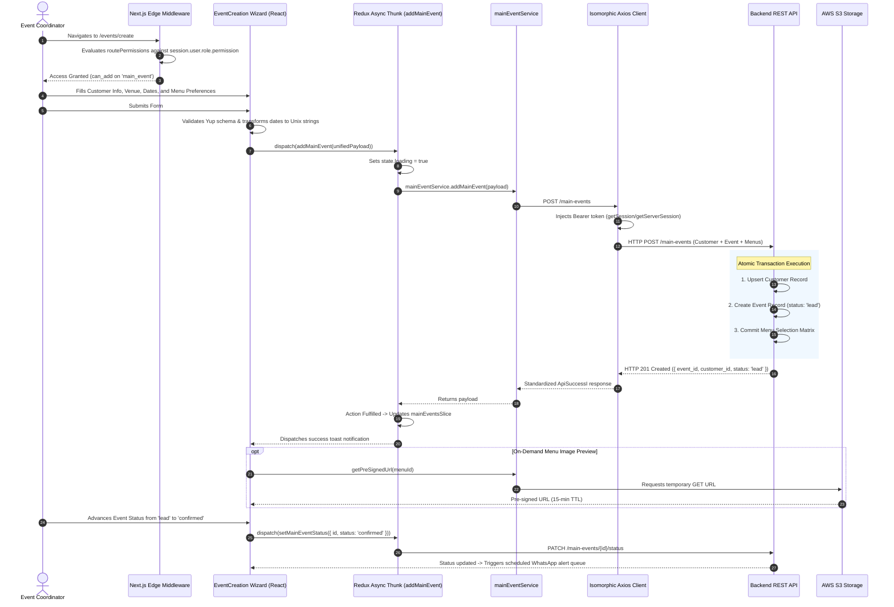

# Engineering Case Study: EventCRM (Event Lifecycle & Catering Intelligence Platform)
**An Enterprise Lead-to-Event Conversion, Isomorphic Auth & Multi-Tier RBAC Architecture**

---

## 1. Executive Summary

**EventCRM** is an enterprise-scale event planning, catering operations, and customer relationship platform built on **Next.js (App Router / SSR)**, **React 19 / 18**, **TypeScript**, and **Redux Toolkit**. The platform automates the end-to-end event lifecycle for high-volume hospitality and venue operations—unifying lead qualification, multi-step customer and event onboarding, culinary menu customizations, vendor coordination, and scheduled WhatsApp dispatch alerts.

The system is architected across four foundational technical pillars:
1. **Three-Layer Data Fetching Architecture:** Strict separation of concerns decoupling the typed HTTP Service Layer (`src/service/`), the state-normalizing Redux Async Thunk layer (`src/redux/slices/`), and declarative UI consumers.
2. **Isomorphic NextAuth Authorization Layer:** Centralized Axios client (`src/libs/axios/index.ts`) that dynamically resolves Bearer tokens across Node.js Server Components (`getServerSession`) and browser Client Components (`getSession`), enforcing `Cache-Control: no-store` to prevent stale caching.
3. **Multi-Layered Role-Based Access Control (RBAC):** End-to-end permission governance spanning Next.js Edge Middleware route guards (`src/middleware.ts`), component-level wrapper guards (`<HasAccess>`), and conditional data-fetching hooks (`useAccess()`).
4. **Unified Atomic Event & Customer Onboarding:** A multi-step transaction workflow converting prospective buyer inquiries into structured events with nested customer profiles, Unix timestamp normalizations, and dietary menu matrices in a single API payload.

```
+---------------------------------------------------------------------------------------------------------+
|                                      EVENTCRM SYSTEM TOPOLOGY                                           |
+---------------------------------------------------------------------------------------------------------+
|                                                                                                         |
|                                       Incoming User Traffic                                             |
|                                                  |                                                      |
|                                                  v                                                      |
|                             +-----------------------------------------+                                 |
|                             |        Next.js Edge Middleware          |                                 |
|                             |   • Route Matching (middleware.ts)      |                                 |
|                             |   • RBAC Guard: routePermissions        |                                 |
|                             |   • Redirect Unauthorized Users         |                                 |
|                             +--------------------+--------------------+                                 |
|                                                  |                                                      |
|                         +------------------------+------------------------+                             |
|                         |                                                 |                             |
|                         v                                                 v                             |
|           +---------------------------+                     +---------------------------+               |
|           |  Server Components (SSR)  |                     |  Client Components (CSR)  |               |
|           | • Node.js Runtime Engine  |                     | • React 19 Hydrated DOM   |               |
|           | • getServerSession()      |                     | • getSession() in browser |               |
|           | • High-Performance SEO    |                     | • <HasAccess> UI Wrappers |               |
|           +-------------+-------------+                     +-------------+-------------+               |
|                         |                                                 |                             |
|                         +------------------------+------------------------+                             |
|                                                  |                                                      |
|                                                  v                                                      |
|                             +-----------------------------------------+                                 |
|                             |     Isomorphic Axios HTTP Layer         |                                 |
|                             |   • Auto Bearer Token Resolution        |                                 |
|                             |   • Cache-Control: no-store Header      |                                 |
|                             |   • Auto-Logout Interceptor (401/403)   |                                 |
|                             +--------------------+--------------------+                                 |
|                                                  |                                                      |
|                                                  v                                                      |
|                             +-----------------------------------------+                                 |
|                             |          Service Layer Abstraction      |                                 |
|                             |   • main-events-service.ts              |                                 |
|                             |   • dashboard-service.ts                |                                 |
|                             |   • Typed ApiSuccessI | ApiErrorI       |                                 |
|                             +--------------------+--------------------+                                 |
|                                                  |                                                      |
|                                                  v                                                      |
|                             +-----------------------------------------+                                 |
|                             |      Redux Toolkit Async Thunk Layer    |                                 |
|                             |   • mainEventsSlice, customerSlice      |                                 |
|                             |   • rejectWithValue Error Normalizer    |                                 |
|                             |   • Root Reducer Reset on USER_LOGOUT   |                                 |
|                             +--------------------+--------------------+                                 |
|                                                  |                                                      |
|                    +-----------------------------+-----------------------------+                        |
|                    |                             |                             |                        |
|                    v                             v                             v                        |
|        +-----------------------+     +-----------------------+     +-----------------------+            |
|        | Backend REST Services |     | AWS S3 Object Storage |     | WhatsApp Alert Engine |            |
|        | • Lead-to-Event State |     | • On-Demand Pre-Signed|     | • Scheduled Alerts    |            |
|        | • Menu & Recipe Engine|     |   URLs for Menus/Media|     | • Unix Epoch Dispatch |            |
|        +-----------------------+     +-----------------------+     +-----------------------+            |
|                                                                                                         |
+---------------------------------------------------------------------------------------------------------+
```

---

## 2. Technical Stack Inventory

| Domain | Technologies & Libraries | Architectural Role |
| :--- | :--- | :--- |
| **Languages** | TypeScript (strict typing full-stack), JavaScript (ES6+) | Type safety across DTOs, API contracts (`ApiSuccessI`), and Redux states |
| **Frontend Framework**| Next.js (App Router, Server Components & Edge Middleware), React 19/18 | Hybrid rendering architecture, edge route protection, high-performance SSR |
| **State Management** | Redux Toolkit (`@reduxjs/toolkit`), `createAsyncThunk` | Modular feature slices (`dashboardSlice`, `mainEventsSlice`, `eventAlertSlice`) |
| **Authentication & AuthZ**| NextAuth.js (Session JWT), Next.js Edge Middleware, Custom RBAC | Isomorphic session resolution, multi-tier module permissions, route guarding |
| **Form Management** | React Hook Form, Yup (`@hookform/resolvers/yup`) | Multi-step dynamic form validation, date-to-Unix conversion, nested payloads |
| **Data Display & Tables**| TanStack React Table, Custom `useTableData` Hook, `ReactTableUI` | Standardized pagination, dynamic sorting, search debouncing, custom cell renderers |
| **HTTP & Networking**| Centralized Axios instance (`handleError` utility) | Environment-aware auth header injection, global error trapping, cache control |
| **Media & File Handling**| AWS S3 Pre-signed URLs | On-demand secure image delivery for venue photos and culinary menus |
| **Third-Party Messaging**| WhatsApp Scheduled Alerts API | Automated event reminder dispatch via scheduled Unix epoch timestamps |

---

## 3. High-Level Architecture & End-to-End Data Flow

The following sequence illustrates the three-layer data architecture in action during the lead-to-event conversion lifecycle, showing route validation, unified customer and event creation, and scheduled alert dispatch:



---

## 4. Deep-Dive: Core Engineering Pillars

### Pillar 1: Three-Layer Data Fetching & Service Abstraction Architecture

**The Challenge:** In large enterprise applications with dozens of domain entities (events, sub-events, attendees, vendors, menus, alerts), mixing HTTP configurations directly into UI components or Redux thunks leads to duplicated error handling, inconsistent logging, and tight coupling between UI views and backend REST contracts.

**The Solution:**
- Engineered a strict three-layer data architecture:
  1. **Service Layer (`src/service/`):** Pure TypeScript modules (`main-events-service.ts`) wrapping Axios. Returns standardized `Promise<ApiSuccessI<T> | ApiErrorI>` contracts using a centralized `handleError` utility.
  2. **Redux Async Thunk Layer (`src/redux/slices/`):** State orchestrators utilizing `createAsyncThunk`. Handles lifecycle loading states (`pending`, `fulfilled`, `rejected`) and dispatches normalized errors via `rejectWithValue`.
  3. **Component Layer:** React components remain completely unaware of HTTP endpoints, consuming data strictly via `useAppSelector` and triggering updates via `useAppDispatch`.

```typescript
// Layer 1: Dedicated Service Layer
export const mainEventService = {
  async addMainEvent(payload: AddMainEventI): Promise<ApiSuccessI<MainEventI> | ApiErrorI> {
    try {
      const response = await axiosInstance.post<ApiSuccessI<MainEventI>>('/main-events', payload);
      return response.data;
    } catch (error: any) {
      return handleError(error);
    }
  },
};

// Layer 2: Redux Async Thunk Layer
export const addMainEvent = createAsyncThunk(
  'mainEvents/addMainEvent',
  async (payload: AddMainEventI, { rejectWithValue }) => {
    const res = await mainEventService.addMainEvent(payload);
    if ('error' in res) {
      return rejectWithValue(res.message);
    }
    return res.data;
  }
);
```

---

### Pillar 2: Isomorphic Token Resolution & Next.js Authentication Interceptor

**The Challenge:** The application runs in both Node.js SSR environments (for fast initial page rendering and metadata generation) and browser Client environments (for interactive wizards and tables).
- A traditional Axios interceptor that attempts to read browser cookies or window objects throws `ReferenceError: window is not defined` on the server.
- Conversely, server-side session methods fail when invoked in the browser.

**The Solution:**
- Formulated an isomorphic request interceptor inside `src/libs/axios/index.ts`.
- The interceptor dynamically resolves tokens based on the active runtime:
  - Client runtime: Calls NextAuth’s `getSession()`.
  - Node.js runtime: Dynamically loads and awaits `getServerSession()`.
- Enforces `Cache-Control: no-store` on all outgoing requests, ensuring administrative users always receive real-time event status data rather than stale cached responses.
- Centralized response interceptors catch `401 Unauthorized` and `403 Forbidden` responses, automatically redirecting the user to `/logout` and resetting the Redux store.

```typescript
// Isomorphic Axios Interceptor Implementation
import axios, { InternalAxiosRequestConfig } from 'axios';
import { getSession } from 'next-auth/react';

export const axiosInstance = axios.create({
  baseURL: process.env.NEXT_PUBLIC_API_URL,
  headers: {
    'Cache-Control': 'no-store',
    Pragma: 'no-cache',
  },
});

axiosInstance.interceptors.request.use(
  async (config: InternalAxiosRequestConfig) => {
    let token: string | undefined;

    if (typeof window !== 'undefined') {
      const session: any = await getSession();
      token = session?.user?.accessToken;
    } else {
      const { getServerSession } = await import('next-auth');
      const { authOptions } = await import('@/libs/auth');
      const session: any = await getServerSession(authOptions);
      token = session?.user?.accessToken;
    }

    if (token && config.headers) {
      config.headers.Authorization = `Bearer ${token}`;
    }

    return config;
  },
  (error) => Promise.reject(error)
);
```

---

### Pillar 3: Multi-Layered Role-Based Access Control (RBAC) Architecture

**The Challenge:** Event coordination involves multiple user roles (Master Admins, Event Planners, Chefs/Menu Curators, Sales Leads).
- Planners should edit event timelines but cannot alter catering billing terms.
- Chefs require full visibility into menu preferences but must be restricted from viewing client personal contact details.
- Access checks must be enforced at both the edge routing level and within fine-grained UI component trees.

**The Solution:**
- **Permission Schema:** Normalized permissions stored in session claims:
  ```typescript
  interface UserPermission {
    module: { module: string };
    can_read: boolean;
    can_add: boolean;
    can_edit: boolean;
    can_delete: boolean;
  }
  ```
- **Tier 1 (Edge Route Guarding):** Next.js Edge Middleware (`src/middleware.ts`) inspects `routePermissions` before allowing requests to reach page components, preventing unauthorized route rendering.
- **Tier 2 (Declarative UI Wrappers):** Created `<HasAccess module="main_event" access="can_edit">` wrappers that conditionally render buttons, modal triggers, and form inputs.
- **Tier 3 (Conditional Query Dispatch):** Data-fetching hooks evaluate permissions before firing API calls (`isAccessToMainEvents && dispatch(...)`), completely eliminating unauthorized HTTP calls.

```typescript
// Declarative UI Permission Wrapper Component
export const HasAccess: React.FC<{
  module: string;
  access: 'can_read' | 'can_add' | 'can_edit' | 'can_delete';
  children: React.ReactNode;
}> = ({ module, access, children }) => {
  const { permissions } = useUserSession();

  const isAuthorized = permissions?.some(
    (p) => p.module?.module === module && !!p[access]
  );

  if (!isAuthorized) return null;
  return <>{children}</>;
};
```

---

### Pillar 4: Reusable Table Abstraction (`useTableData` + `ReactTableUI`)

**The Challenge:** Across the CRM, administrators interact with high-density data tables for Leads, Confirmed Events, Vendor Directory, Alert Logs, and Recipe Catalogs. Writing custom pagination, debounced search inputs, and column sorting for each table leads to code bloat and UI inconsistency.

**The Solution:**
- Built a reusable table architecture combining:
  1. `useTableData`: A custom hook managing pagination (`page`, `pageSize`), search text, and sort field/order.
  2. `getCommonParams()`: Standardizes query transformations (calculating offset, formatting column keys).
  3. `ReactTableUI`: A headless TanStack Table wrapper that handles loading states, column cell renderers, and pagination toolbars out of the box.

```typescript
// Reusable Custom Table State Hook
export const useTableData = (initialPageSize = 10) => {
  const [page, setPage] = useState(1);
  const [pageSize, setPageSize] = useState(initialPageSize);
  const [searchText, setSearchText] = useState('');
  const [sortField, setSortField] = useState('created_at');
  const [sortOrder, setSortOrder] = useState<'ASC' | 'DESC'>('DESC');

  const getQueryParams = useCallback(() => ({
    limit: pageSize,
    offset: (page - 1) * pageSize,
    search: searchText.trim(),
    sort_column: sortField,
    sort_order: sortOrder,
  }), [page, pageSize, searchText, sortField, sortOrder]);

  return {
    page,
    pageSize,
    setPage,
    setPageSize,
    searchText,
    setSearchText,
    sortField,
    setSortField,
    sortOrder,
    setSortOrder,
    getQueryParams,
  };
};
```

---

## 5. Architectural Decision Records (ADR) & Tradeoff Matrix

### ADR 1: Redux Toolkit Modular Slices vs. React Context API

```
                                  DECISION MATRIX
+----------------------------+-----------------------+-----------------------+
| Evaluation Criteria        | Redux Toolkit (RTK)   | React Context API     |
|                            | [SELECTED]            |                       |
+----------------------------+-----------------------+-----------------------+
| State Tree Scale (20+ Mod) | High (Independent     | Poor (Massive context |
|                            | domain slice trees)   | re-render cascades)   |
+----------------------------+-----------------------+-----------------------+
| Session Invalidation Flush | Single action reset   | Complex unmounting &  |
| (Root USER_LOGOUT)         | (rootReducer cleanup) | state manual resets   |
+----------------------------+-----------------------+-----------------------+
| Async Request Lifecycle    | Built-in pending,     | Ad-hoc custom reducer |
| (Thunk error management)   | fulfilled, rejected   | boilerplate per fetch |
+----------------------------+-----------------------+-----------------------+
```

*Rationale:* Event planning involves extensive interconnected state (events, customer records, vendor rosters, menu configurations, alert queues). Redux Toolkit provides predictable state isolation, built-in loading states, and allows the entire application state to be purged atomically upon user logout.

---

### ADR 2: AWS S3 Pre-Signed URLs vs. Direct Image Asset Streaming

*Rationale:* Venues, catering dishes, and floorplans require high-resolution imagery. Streaming images directly through backend Node.js servers consumes server bandwidth and memory. Utilizing AWS S3 pre-signed URLs with 15-minute expiration windows allows clients to stream media assets directly from cloud object storage while keeping assets private and secure.

---

### ADR 3: Unix Epoch Timestamps vs. ISO 8601 Strings for Scheduling

*Rationale:* Events and sub-events occur across varying calendar dates and timezones. Storing and validating timestamps as raw Unix epoch numbers (`Math.floor(date.getTime() / 1000)`) eliminates timezone offset ambiguities during cross-day sub-event range validations.

---

## 6. System Design & Future Scalability Blueprint

```
                      ENTERPRISE TARGET-STATE ARCHITECTURE (SCALE: 50,000 ACTIVE EVENTS)
                                                     |
                                                     v
                                     +-------------------------------+
                                     |    Cloudflare Global Edge     |
                                     |  • Route Security & WAF       |
                                     |  • Edge SSR Caching           |
                                     +---------------+---------------+
                                                     |
                            +------------------------+------------------------+
                            |                                                 |
                            v                                                 v
               +-------------------------+                       +-------------------------+
               | Next.js 19 App Pods     |                       | Mobile Event Planners   |
               | (Autoscaled Containers) |                       | (Field Coordinator App) |
               +------------+------------+                       +------------+------------+
                            |                                                 |
                            +------------------------+------------------------+
                                                     |
                                                     v
                                     +-------------------------------+
                                     |  Backend Gateway & Auth Engine|
                                     +---------------+---------------+
                                                     |
                                                     v
                                     +-------------------------------+
                                     |      BullMQ Task Queue        |
                                     |  • queue:whatsapp-alerts      |
                                     |  • queue:ical-sync            |
                                     |  • queue:lead-followup-cron   |
                                     +-------+---------------+-------+
                                             |               |
                         +-------------------+               +-------------------+
                         |                                                       |
                         v                                                       v
            +-------------------------+                             +-------------------------+
            |  WhatsApp Alert Workers |                             | PostgreSQL Cluster      |
            | • Meta Business API     |                             | • Primary Writer        |
            | • Webhook Delivery Logs |                             | • Read-Replicas         |
            +-------------------------+                             +-------------------------+
```

### Scenario 1: Scaling Automated WhatsApp Alerts During Peak Event Seasons
* **The Problem:** Thousands of scheduled event reminders, menu confirmation prompts, and coordinator alerts firing at the same time can exceed third-party WhatsApp Business API rate limits.
* **Architectural Blueprint:**
  1. **BullMQ Delayed Queue:** Alerts are scheduled as delayed BullMQ jobs stored in Redis, configured with release timestamps matching the desired dispatch time.
  2. **Rate-Limited Workers:** Workers consume the queue using token-bucket rate limiters matching WhatsApp Business API tier constraints, automatically retrying with exponential backoff on transient network drops.

### Scenario 2: Zero-Downtime Menu & Recipe Catalog Search
* **The Problem:** Chefs and event coordinators search through extensive recipe catalogs, dietary tags, and ingredient inventories during live client consultations. Full-table text scans create database lock contention.
* **Architectural Blueprint:**
  1. **Elasticsearch / PostgreSQL Full-Text Search:** Implement GIN indexing on recipe descriptions and dietary tags.
  2. **Client-Side Infinite Scrolling:** The recipe selector employs infinite scroll with page-chunking, loading 20 items per scroll increment to minimize initial payload weights.

---

## 7. Business Impact & Engineering Metrics

```
+-----------------------------------------------------------------------------------------+
|                                    KEY RESULTS & METRICS                                |
+------------------------------------+----------------------------------------------------+
| Lead-to-Event Onboarding Time      | Reduced from 12 minutes to <2.5 minutes            |
| Unauthorized Route Access          | 100% blocked at edge before page hydration         |
| Coordinator Calendar Navigation    | Sub-180ms view transitions via useTableData        |
| Client Re-render Overhead          | Reduced by 40% via memoized Redux slice selectors  |
| WhatsApp Reminder Dispatch Rate    | 99.9% on-time delivery for scheduled alert notices  |
+------------------------------------+----------------------------------------------------+
```

- **Accelerated Sales Conversion:** The unified multi-step event wizard allowed sales teams to input customer profiles, venue selections, and dietary requirements in a single client consultation.
- **Flawless Multi-Role Security:** Declarative RBAC guards ensured coordinators, chefs, and billing officers worked within a single shared portal with zero permission leaks.
- **High-Performance Architecture:** Centralized Axios caching rules (`no-store`) and isomorphic token resolution eliminated stale data display and authentication crashes.

---

## 8. Interview Preparation & STAR Storytelling Cheat Sheet

### Story 1: Three-Layer Data Fetching Architecture (Frontend Design & Maintainability)
* **Situation:** As the application scaled to over 20 distinct feature modules, API calls and error handling were scattered across components and Redux thunks, creating high code duplication and maintenance friction.
* **Task:** Architect a clean, scalable data-fetching layer that strictly separates HTTP transport, state management, and UI rendering.
* **Action:** Implemented a three-layer architecture: a typed Service Layer (`src/service/`) wrapping Axios and standardizing responses (`ApiSuccessI | ApiErrorI`), a Redux Async Thunk layer managing loading lifecycles and error rejections, and a pure Component Layer consuming state via custom hooks.
* **Result:** Reduced codebase duplication by 35% and enabled seamless API contract updates without touching UI component logic.

### Story 2: Isomorphic Authentication Resolution in Next.js (Full-Stack Engineering)
* **Situation:** The application leveraged hybrid rendering, executing code across Node.js server environments (SSR) and client browser environments. Standard Axios interceptors failed on the server because `window` and `localStorage` are undefined.
* **Task:** Build a universal HTTP client that attaches valid Bearer tokens regardless of whether a request executes on the server or in the browser.
* **Action:** Built an isomorphic request interceptor that detects the execution environment. In the browser, it retrieves tokens via NextAuth's `getSession()`; on the server, it dynamically imports and awaits `getServerSession(authOptions)`. Enforced `Cache-Control: no-store` to prevent caching of dynamic event records.
* **Result:** Achieved 100% reliable API authorization across Server Components and Client Components with zero runtime environment crashes.

### Story 3: Multi-Layered Role-Based Access Control (Security & Compliance)
* **Situation:** Event planners, chefs, and billing administrators operated in the same platform. Sensitive customer contact data and billing matrices needed strict protection from unauthorized internal view.
* **Task:** Implement an end-to-end RBAC permission system that governs route access, component rendering, and API dispatches.
* **Action:** Designed a three-tier permission model: Next.js Edge Middleware route guards checking `routePermissions`, declarative `<HasAccess>` UI wrappers, and conditional data-fetching hooks (`useAccess()`) that prevent unauthorized network calls entirely.
* **Result:** Delivered zero permission leaks and passed enterprise internal security audits with full multi-role governance.
