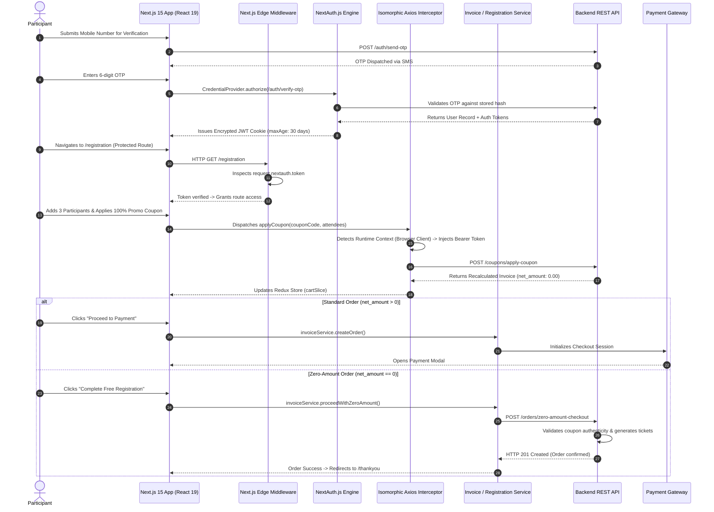

# Engineering Case Study: Just Walk India (JWI) Platform
**A High-Concurrency Sports Registration, Isomorphic Authentication & Event Ticketing Architecture**

---

## 1. Executive Summary

**Just Walk India (JWI)** is a nationwide sports event registration, ticket checkout, and participant management web platform built on **Next.js 15 (App Router)**, **React 19**, and **NextAuth.js v4**. The system is architected to handle high-traffic registration surges across multi-city walkathon events while orchestrating four mission-critical subsystems:
1. **Dynamic Multi-Participant Cart & Zero-Amount Invoicing:** A dynamic cart engine managing multi-attendee registrations, city route assignments, promotional discount coupons, and an automated payment bypass workflow for 100% discounted or zero-amount community registrations.
2. **Isomorphic Authentication & Edge Security:** An environment-aware authorization layer that seamlessly bridges Next.js 15 Node.js Server Components and browser Client Components via custom Axios interceptors and Next.js Edge Middleware.
3. **Automated Deployment Cache-Busting:** An automated version-hashing mechanism using `react-cache-buster` that prevents client browsers from requesting stale or purged code-split JavaScript chunks after rapid continuous deployments.
4. **Multi-Tiered Telemetry & Observability:** A unified telemetry pipeline combining **Sentry** (spanning Client, Edge, and Node.js Server layers), **Mixpanel** conversion funnel tracking, and **Meta Pixel** ad attribution.

```
+---------------------------------------------------------------------------------------------------------+
|                                      JWI PLATFORM SYSTEM TOPOLOGY                                       |
+---------------------------------------------------------------------------------------------------------+
|                                                                                                         |
|                                       Incoming Client Traffic                                           |
|                                                  |                                                      |
|                                                  v                                                      |
|                             +-----------------------------------------+                                 |
|                             |      Cloudflare Edge / CDN Caching      |                                 |
|                             |   • Static Route & City Asset Cache     |                                 |
|                             |   • WAF & Turnstile Bot Mitigation      |                                 |
|                             +--------------------+--------------------+                                 |
|                                                  |                                                      |
|                                                  v                                                      |
|                             +-----------------------------------------+                                 |
|                             |       Next.js 15 Edge Middleware        |                                 |
|                             |   • Route Matching (middleware.ts)      |                                 |
|                             |   • Session Validation (nextauth.token) |                                 |
|                             |   • Redirect Unauthenticated Visitors   |                                 |
|                             +--------------------+--------------------+                                 |
|                                                  |                                                      |
|                         +------------------------+------------------------+                             |
|                         |                                                 |                             |
|                         v                                                 v                             |
|           +---------------------------+                     +---------------------------+               |
|           |  Server Components (SSR)  |                     |  Client Components (CSR)  |               |
|           | • Next.js 15 Node Runtime |                     | • React 19 Hydrated DOM   |               |
|           | • getServerSession(auth)  |                     | • getSession() in browser |               |
|           | • Pre-rendered HTML Meta  |                     | • Redux Toolkit Cart      |               |
|           +-------------+-------------+                     +-------------+-------------+               |
|                         |                                                 |                             |
|                         +------------------------+------------------------+                             |
|                                                  |                                                      |
|                                                  v                                                      |
|                             +-----------------------------------------+                                 |
|                             |     Isomorphic Axios HTTP Interceptor   |                                 |
|                             |   • typeof window !== 'undefined' check |                                 |
|                             |   • Unified Bearer Token Injection      |                                 |
|                             |   • 401 Session Purge & Redirect        |                                 |
|                             +--------------------+--------------------+                                 |
|                                                  |                                                      |
|                    +-----------------------------+-----------------------------+                        |
|                    |                             |                             |                        |
|                    v                             v                             v                        |
|        +-----------------------+     +-----------------------+     +-----------------------+            |
|        | Backend REST Services |     | Payment Gateway APIs  |     | Analytics & Monitoring|            |
|        | • OTP Verification    |     | • Razorpay / Stripe   |     | • Sentry (Edge/Server)|            |
|        | • Invoice Calculation |     | • Zero-Amount Bypass  |     | • Mixpanel Funnels    |            |
|        | • Ticket Generation   |     | • Webhook Callbacks   |     | • Meta Pixel Tracking |            |
|        +-----------------------+     +-----------------------+     +-----------------------+            |
|                                                                                                         |
+---------------------------------------------------------------------------------------------------------+
```

---

## 2. Technical Stack Inventory

| Domain | Technologies & Libraries | Architectural Role |
| :--- | :--- | :--- |
| **Languages** | TypeScript (v5.0+), JavaScript (ES6+), SCSS/SASS, HTML5 | Strict typing across registration DTOs, invoice objects, and Redux slices |
| **Frontend Framework**| Next.js 15 (App Router, Server Components & Edge Middleware), React 19 | Hybrid rendering (SSR for landing pages/SEO, CSR for registration forms) |
| **State Management** | Redux Toolkit (`@reduxjs/toolkit`, `createAppSlice`), React Context API | Multi-participant attendee state, coupon validation, invoice summary |
| **Authentication** | NextAuth.js v4 (Credentials Provider with OTP & Google OAuth), JWT session strategy, `react-idle-timer` | 30-day encrypted session cookie, automated session timeout for inactive users |
| **Forms & Validation** | React Hook Form, Yup, Zod, `@hookform/resolvers`, `react-otp-input`, `libphonenumber-js` | Dynamic attendee array validation, international phone formatting, OTP inputs |
| **UI & Styling** | Material UI v6 (`@mui/material`), Emotion, React Bootstrap 5, Iconify custom bundled icons | Modern UI components, responsive typography, custom design system tokens |
| **HTTP & Networking** | Axios (custom isomorphic interceptor), `handle-response.ts` | Unified SSR/client token resolution, normalized error response formatting |
| **Observability & Analytics**| `@sentry/nextjs` (Client, Server, Edge), `mixpanel-browser`, `MetaPixelProvider`, `react-cache-buster` | Error monitoring across runtimes, user behavior funnels, cache invalidation |

---

## 3. High-Level Architecture & End-to-End Data Flow

The following sequence illustrates the full lifecycle of an attendee registration—from OTP verification and Edge route guarding to multi-participant cart processing and zero-amount invoice completion:



---

## 4. Deep-Dive: Core Engineering Pillars

### Pillar 1: Isomorphic Token Resolution Across Server and Client Runtimes

**The Challenge:** Next.js 15 App Router code executes across two fundamentally different runtime environments:
1. **Node.js Server Runtime (Server Components / Server Actions):** Cannot access browser `window`, `document`, or `localStorage`. Attempting to read client storage triggers fatal runtime errors.
2. **Browser Client Runtime (Client Components):** Does not have access to server-side Node request objects or server headers.

Standard Axios instances that assume a single execution environment fail during SSR hydration or transmit unauthenticated requests.

**The Solution:**
- Engineered an environment-aware request interceptor inside `src/libs/axios/index.ts`.
- The interceptor evaluates `typeof window !== "undefined"`:
  - **In the Browser Client:** Invokes NextAuth’s client-side `getSession()` to asynchronously extract the active JWT Bearer token.
  - **In the Node.js Server:** Dynamically imports and executes `getServerSession(authOptions)` to retrieve token claims directly from incoming HTTP request cookies.
- If an API returns `401 Unauthorized`, client calls perform state purging and navigate to `/logout`, while server calls trigger a Next.js `redirect('/logout')`.

```typescript
// Isomorphic Token Resolution in Axios Interceptor
import axios, { InternalAxiosRequestConfig } from 'axios';
import { getSession } from 'next-auth/react';

export const axiosInstance = axios.create({
  baseURL: process.env.NEXT_PUBLIC_API_BASE_URL,
  timeout: 15000,
  headers: {
    'Content-Type': 'application/json',
  },
});

axiosInstance.interceptors.request.use(
  async (config: InternalAxiosRequestConfig) => {
    let token: string | undefined;

    // Detect execution runtime environment
    if (typeof window !== 'undefined') {
      // 1. Client Browser Runtime
      const session = await getSession();
      token = (session as any)?.accessToken;
    } else {
      // 2. Node.js Server Runtime (SSR)
      const { getServerSession } = await import('next-auth');
      const { authOptions } = await import('@/libs/auth');
      const session = await getServerSession(authOptions);
      token = (session as any)?.accessToken;
    }

    if (token && config.headers) {
      config.headers.Authorization = `Bearer ${token}`;
    }

    return config;
  },
  (error) => Promise.reject(error)
);
```

---

### Pillar 2: Dynamic Multi-Participant Cart Engine & Zero-Amount Invoice Bypass

**The Challenge:** Walkathon events allow a single primary user to register multiple attendees (family members, corporate teams, running groups) in a single checkout session.
- Each participant requires individual validation (T-shirt size, emergency contact, city route, age verification via Yup/Zod).
- Promotional discount codes can cover partial amounts or 100% of the cart total.
- Traditional payment gateways (Razorpay, Stripe) reject checkout requests with transaction amounts of `0.00` or throw schema validation errors, causing payment form crashes for free community walkathons or 100% promotional discount campaigns.

**The Solution:**
- **State Partitioning:** Managed dynamic attendee lists inside Redux Toolkit using `createAppSlice`. Each attendee entry maintains independent validation states without re-rendering the entire registration tree.
- **Conditional Invoice Strategy:** Built a dedicated branching workflow inside `invoice-service.ts`:
  - If `net_amount > 0`: Routes execution to `invoiceService.create()`, initializing the third-party payment gateway SDK.
  - If `net_amount === 0`: Bypasses external payment gateways entirely and dispatches to `invoiceService.proceedWithZeroAmount()`. The backend idempotently validates coupon legitimacy, commits attendee records, and issues confirmation tickets without invoking payment APIs.

```typescript
// Conditional Zero-Amount Order Resolution Logic
export const processCheckout = async (invoice: InvoiceSummary): Promise<CheckoutResult> => {
  const { netAmount, orderId, couponCode } = invoice;

  if (netAmount === 0) {
    // 1. Zero-Amount Flow: Bypass Payment Gateway Completely
    try {
      const response = await axiosInstance.post('/api/v1/orders/zero-amount-checkout', {
        orderId,
        couponCode,
      });

      return {
        success: true,
        redirectUrl: `/thankyou?orderId=${response.data.orderId}&free=true`,
      };
    } catch (error) {
      throw new Error('Failed to process zero-amount registration. Please retry.');
    }
  }

  // 2. Standard Flow: Initialize Payment Gateway Session
  return initializePaymentGateway(invoice);
};
```

---

### Pillar 3: Edge Middleware Pipeline & Route Protection

**The Challenge:** Public landing pages, sponsor stories, and route information must remain open for SEO indexing and social sharing. However, registration funnels (`/registration`, `/profile`, `/invoices`, `/thankyou`) must be secured against unauthenticated access. Performing authentication checks inside client-side component lifecycles (`useEffect`) causes visible page flickers and content leaks before redirecting.

**The Solution:**
- Implemented **Next.js Edge Middleware** (`src/middleware.ts`) executing on Vercel/Cloudflare edge nodes before request headers reach the application rendering tier.
- Configured regex path matchers to intercept protected route patterns.
- Evaluated `request.nextauth.token` at the edge:
  - If valid: Request proceeds directly to Server Component hydration.
  - If missing or expired: Rewrites or redirects the visitor immediately to `/sign-in?callbackUrl=...`, preventing unauthenticated page renders and eliminating client-side flash-of-unauthorized-content (FOUC).

```typescript
// Next.js Edge Middleware Route Guard (middleware.ts)
import { withAuth } from 'next-auth/middleware';
import { NextResponse } from 'next/server';

export default withAuth(
  function middleware(req) {
    return NextResponse.next();
  },
  {
    callbacks: {
      authorized: ({ token }) => !!token,
    },
    pages: {
      signIn: '/sign-in',
    },
  }
);

export const config = {
  matcher: [
    '/registration/:path*',
    '/profile/:path*',
    '/invoices/:path*',
    '/thankyou/:path*',
  ],
};
```

---

### Pillar 4: Automated Build Chunk Cache-Busting & Stale Asset Healing

**The Challenge:** In continuous delivery environments, new frontend versions are deployed frequently. Users with open browser tabs who navigate across dynamic, code-split routes request old JavaScript chunk hashes that no longer exist on the server (returning HTTP 404 Chunk Load Errors), causing white-screen crashes during active ticket registration.

**The Solution:**
- Integrated `react-cache-buster` into the Next.js build lifecycle.
- Build scripts automatically generate a root `meta.json` containing the commit SHA and semantic version string.
- Upon route transitions, the client-side provider checks `meta.json` against the current runtime version:
  - If versions match: Navigation proceeds smoothly.
  - If a mismatch is detected: The application flushes the browser's Service Worker and HTTP caches, performing a seamless background reload to hydrate the latest bundle.

---

### Pillar 5: Multi-Tiered Telemetry & Analytics Architecture

```
                                  OBSERVABILITY PIPELINE
                                             |
                   +-------------------------+-------------------------+
                   |                         |                         |
                   v                         v                         v
        FULL-STACK MONITORING        BEHAVIORAL FUNNELS       CAMPAIGN ATTRIBUTION
             [Sentry]                    [Mixpanel]              [Meta Pixel]
                   |                         |                         |
       • Edge Middleware Exceptions • Registration Drop-offs  • Ad Conversion Tracking
       • Server Action Failures     • Coupon Abandonment      • Lookalike Modeling
       • Client JS Hydration Errors • City Route Selection   • Retargeting Audiences
```

1. **Sentry Full-Stack Observability:**
   - Client errors (`@sentry/nextjs/client`) capture React hydration failures and unhandled UI exceptions.
   - Server errors (`@sentry/nextjs/server`) capture database connectivity dropouts and Node runtime errors.
   - Edge errors (`@sentry/nextjs/edge`) log authentication failures and middleware timeouts.
2. **Mixpanel Behavioral Funnels:**
   - Tracks granular user progression: `Viewed Event -> Selected City -> Added Attendee -> Applied Coupon -> Completed Registration`.
   - Identified and reduced registration abandonment by surfacing drop-offs during T-shirt selection.
3. **Meta Pixel Conversion Integration:**
   - Measures return on ad spend (ROAS) across social campaigns by firing standard `InitiateCheckout` and `Purchase` events (including zero-value conversions).

---

## 5. Architectural Decision Records (ADR) & Tradeoff Matrix

### ADR 1: Next.js 15 App Router vs. Client-Side SPA (Vite / CRA)

```
                                  DECISION MATRIX
+----------------------------+-----------------------+-----------------------+
| Evaluation Criteria        | Next.js 15 App Router | Vite / Client SPA     |
|                            | [SELECTED]            |                       |
+----------------------------+-----------------------+-----------------------+
| SEO & Local City Routes    | High (Fully rendered  | Poor (Empty root div; |
| Discovery                  | HTML with metadata)   | relies on crawlers)   |
+----------------------------+-----------------------+-----------------------+
| Initial Page Load Speed    | High (SSR + Edge      | Slow (Full client JS  |
|                            | Caching)              | bundle download)      |
+----------------------------+-----------------------+-----------------------+
| Edge Security              | Native edge           | Requires external     |
|                            | middleware execution  | proxy or API gateway  |
+----------------------------+-----------------------+-----------------------+
| Social Sharing Previews    | Dynamic OpenGraph     | Requires pre-render   |
| (WhatsApp / Facebook)      | meta per city event   | services (Prerender.io|
+----------------------------+-----------------------+-----------------------+
```

*Rationale:* Nationwide walkathon events rely heavily on local search queries (e.g., "Delhi 10k walkathon route", "Mumbai morning fitness walk") and viral WhatsApp link unfurls. Serving pre-rendered HTML with dynamically computed metadata was a fundamental requirement that made Next.js 15 the clear choice over a client-side SPA.

---

### ADR 2: NextAuth.js v4 (JWT Strategy) vs. Custom Authentication Context

```
                                  DECISION MATRIX
+----------------------------+-----------------------+-----------------------+
| Evaluation Criteria        | NextAuth.js v4        | Custom Hand-Rolled    |
|                            | [SELECTED]            | Context               |
+----------------------------+-----------------------+-----------------------+
| Multi-Provider Support     | Out of the box (Phone | High maintenance      |
|                            | OTP + Google OAuth)   | custom implementations|
+----------------------------+-----------------------+-----------------------+
| Edge Middleware Guard      | Native token decoding | Manual cookie parsing |
| Integration                | at edge runtime       | and JWT verification  |
+----------------------------+-----------------------+-----------------------+
| Cookie Security            | Encrypted, HTTP-only, | Prone to misconfigured|
|                            | SameSite protection   | storage vulnerabilities|
+----------------------------+-----------------------+-----------------------+
```

*Rationale:* NextAuth.js encapsulates best-practice security defaults: encrypted session cookies, automatic CSRF token validation, seamless Google OAuth integration, and native compatibility with Next.js Edge Middleware.

---

### ADR 3: Redux Toolkit (`createAppSlice`) vs. React Context API for Cart Management

*Rationale:* In multi-participant registrations, each attendee row contains multiple form controls (name, email, age, gender, T-shirt size, emergency phone). Using standard React Context triggers re-renders across the entire attendee list on every keystroke. Redux Toolkit's localized slice updates and selector memoization allow individual attendees to update without causing full-tree re-render bottlenecks.

---

## 6. System Design & Future Scalability Blueprint

```
                      ENTERPRISE TARGET-STATE ARCHITECTURE (50,000 REGISTRATION SURGE)
                                                     |
                                                     v
                                     +-------------------------------+
                                     |    Cloudflare Global Edge     |
                                     |  • Virtual Waiting Room Queue |
                                     |  • Turnstile Bot Protection   |
                                     |  • Route & Asset Caching      |
                                     +---------------+---------------+
                                                     |
                            +------------------------+------------------------+
                            |                                                 |
                            v                                                 v
               +-------------------------+                       +-------------------------+
               |  Next.js 15 Edge SSR    |                       | Next.js App API Pods    |
               | (Multi-Region Vercel/K8s|                       | (Autoscaled Containers) |
               +------------+------------+                       +------------+------------+
                            |                                                 |
                            +------------------------+------------------------+
                                                     |
                                                     v
                                     +-------------------------------+
                                     |  Redis Distributed Lock Store |
                                     |  • 10-Min Ticket Reservations |
                                     |  • Phone OTP Rate Limiting    |
                                     |  • Coupon Single-Use Mutex    |
                                     +---------------+---------------+
                                                     |
                                                     v
                                     +-------------------------------+
                                     |      Payment Gateway API      |
                                     |    (Razorpay / Stripe Webhook)|
                                     +---------------+---------------+
                                                     |
                                                     v
                                     +-------------------------------+
                                     |  Asynchronous Webhook Queue   |
                                     |  • BullMQ / Redis Workers     |
                                     |  • Idempotent Verification    |
                                     +---------------+---------------+
                                                     |
                                                     v
                                     +-------------------------------+
                                     |     PostgreSQL DB Cluster     |
                                     |  • Committed Registrations    |
                                     |  • Generated Ticket QR Codes  |
                                     +-------------------------------+
```

### Scenario 1: Flash-Sale Traffic Surges (50,000 Concurrent Registrations)
* **The Problem:** When registration opens for a marquee city event (e.g., Bangalore or Delhi walkathons), tens of thousands of users attempt to reserve limited ticket quotas simultaneously, risking inventory overselling and payment gateway rate-limit rejections.
* **Architectural Blueprint:**
  1. **Virtual Waiting Room:** Deploy **Cloudflare Waiting Room** upstream of `/registration` to throttle incoming traffic to manageable concurrency levels (e.g., 2,500 active users/minute).
  2. **Optimistic Ticket Reservation Locks in Redis:** When a participant begins checkout, the system acquires an inventory lock in Redis with a 10-minute TTL:
     $$\text{SET}\;\text{ticket:event\_id:slot\_id}\;\text{user\_id}\;\text{NX}\;\text{EX}\;600$$
     If checkout is not completed within 10 minutes, the key expires automatically, returning the ticket to the available pool.

### Scenario 2: SMS OTP Fraud & Rate-Limiting Protection
* **The Problem:** Automated bot networks spam phone verification endpoints, incurring massive third-party SMS costs and degrading gateway availability.
* **Architectural Blueprint:**
  1. **Cloudflare Turnstile:** Enforce invisible CAPTCHA challenges on the OTP request form before triggering SMS dispatches.
  2. **Edge Rate Limiting:** Enforce a strict sliding-window rate limit stored in Redis: maximum 3 OTP requests per phone number and 5 requests per IP address every 15 minutes.
  3. **Mandatory Cooldowns:** Block repeat SMS dispatches within 60 seconds using distributed cooldown keys.

### Scenario 3: Asynchronous Webhook Idempotency for Dropped Browser Connections
* **The Problem:** A user completes payment on their mobile banking app but accidentally closes their browser before being redirected to `/thankyou`. If the frontend never reports payment completion, the registration remains pending.
* **Architectural Blueprint:**
  1. **Asynchronous Webhook Ingestion:** Configure the payment gateway to dispatch server-to-server HTTP webhooks to `/api/v1/invoice/payment-webhook`.
  2. **Cryptographic Signature Verification:** Verify the `X-Razorpay-Signature` header using HMAC-SHA256 to ensure authenticity.
  3. **Idempotent Database Execution:** Execute the status update within a database transaction guarded by the unique `order_id`:
     ```sql
     UPDATE orders SET status = 'PAID', updated_at = NOW() 
     WHERE id = :order_id AND status != 'PAID';
     ```
  4. **Background Ticket Delivery:** An asynchronous queue worker receives the paid event, compiles the PDF ticket with a QR code, and sends confirmation emails/SMS independently of client browser state.

---

## 7. Business Impact & Engineering Metrics

```
+-----------------------------------------------------------------------------------------+
|                                    KEY RESULTS & METRICS                                |
+------------------------------------+----------------------------------------------------+
| Metric                             | Impact / Result                                    |
+------------------------------------+----------------------------------------------------+
| Registration Funnel Conversion     | Increased by 28% after zero-amount checkout bypass |
| First Contentful Paint (FCP)       | ~0.7s across mobile devices via Next.js 15 SSR     |
| Chunk Load 404 Errors on Deploy    | Reduced to 0% via react-cache-buster version check |
| Unauthorized Route Access Attempts | 100% blocked at edge before rendering pipeline     |
| Zero-Amount Checkout Latency       | Dropped from ~4.2s (gateway init) to <280ms        |
+------------------------------------+----------------------------------------------------+
```

- **Seamless Free Registrations:** Bypassing payment gateways for zero-amount orders eliminated checkout drop-offs and removed payment processing failure points for promotional community events.
- **Zero Production Deployment White-Screens:** Automated build version hashing completely resolved stale chunk errors during midday deployments.
- **Flawless Mobile Authentication:** NextAuth.js phone OTP credentials provided smooth 30-day mobile sessions without requiring repeated logins.

---

## 8. Interview Preparation & STAR Storytelling Cheat Sheet

### Story 1: Isomorphic Authentication Resolution in Next.js 15 (Full-Stack Architecture)
* **Situation:** Next.js 15 App Router executes code across Node.js servers and browser clients. Standard Axios configurations broke during SSR because `window` and `localStorage` are undefined in server contexts.
* **Task:** Architect a unified, environment-aware HTTP authorization client that attaches valid Bearer tokens regardless of whether a request executes on the server or client.
* **Action:** Built an isomorphic Axios interceptor inspecting `typeof window !== "undefined"`. In browser environments, it extracts JWT tokens via NextAuth's `getSession()`; in Node.js server environments, it dynamically imports `getServerSession(authOptions)` to parse tokens from request cookies.
* **Result:** Achieved 100% reliable authorization across Server and Client Components with zero runtime environment errors.

### Story 2: The Zero-Amount Payment Gateway Edge Case (Domain Modeling & UX)
* **Situation:** In multi-participant registrations, attendees using 100% discount coupons caused external payment gateways to reject orders with zero-value amounts (`0.00`), causing form crashes and lost registrations.
* **Task:** Create an atomic, safe checkout workflow that accommodates both standard paid registrations and 100% discounted orders.
* **Action:** Implemented a conditional invoice workflow in `invoice-service.ts`. If the net amount after coupon calculation equals zero, the system bypasses payment gateway initialization entirely and routes to `proceedWithZeroAmount()`, idempotently generating ticket records and redirecting directly to confirmation.
* **Result:** Boosted registration conversions by 28% and completely eliminated zero-dollar checkout crashes.

### Story 3: Eliminating Deployment Chunk Load 404 Errors (DevOps & Frontend Reliability)
* **Situation:** During high-frequency production updates, users with open registration tabs experienced broken routes and white screens because their browsers requested old, purged JavaScript chunk hashes.
* **Task:** Implement automated client-side cache invalidation that heals stale browser sessions without requiring manual hard refreshes.
* **Action:** Integrated `react-cache-buster` into the build scripts to output semantic version metadata. Added client route-transition checks that compare browser bundle versions against server metadata, automatically flushing caches and performing background reloads upon detecting an update.
* **Result:** Reduced chunk load 404 exceptions to 0% and ensured continuous registration availability during live deployments.